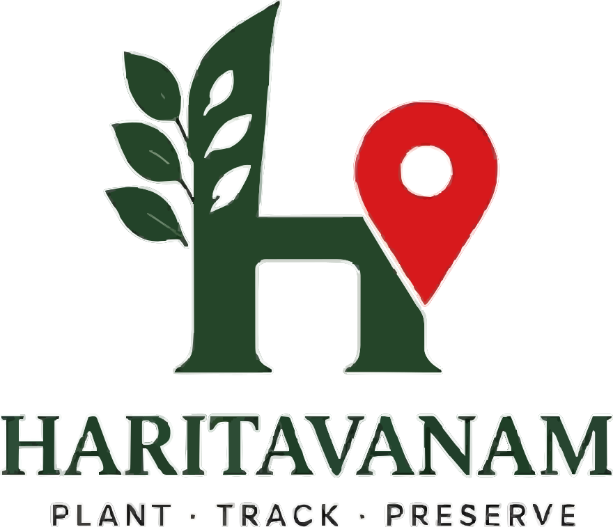

# Haritavanam


> **Plant · Track · Preserve** — A production-grade installable PWA for registering, monitoring, and caring for trees and planted fields. Built as a local-first app that works standalone (no backend required) and plugs into MongoDB when you're ready for the cloud.

<div align="center">

[](https://vercel.com)
[](https://web.dev/progressive-web-apps/)
[](https://react.dev)
[](https://vite.dev)

</div>

---

## 🌱 What is Haritavanam?

Haritavanam is a capstone-grade field companion for urban greening. It replaces the shared notebook that gets lost after two monsoons with a durable digital record:

- **Twelve plants, two fields, three roles** seeded as demo data at GITAM University, Bengaluru.
- **QR labels** on every tree — scan to open a public page with name, age, health, and care count (no personal data, no field boundaries).
- **Two-person rule**: one owner, at most one monitor per record. Owners nominate; only administrators approve.
- **Care logging**: watering, feeding, pruning, inspections — timestamped events with a named actor.
- **Support tickets & admin queue**: report issues, triage status, and approve monitoring requests.
- **Works offline**: data lives in the browser (IndexedDB). Install it on your phone and it keeps running without a server.

---

## 📱 Screenshots

### Splash & Welcome


### App Icon
<div align="center">
  
  
</div>

### Logo


---

## 🚀 Demo Accounts

All demo accounts share the same password: **`Haritavanam@123`**

| Email | Role | What they can do |
|-------|------|------------------|
| `admin@haritavanam.test` | Administrator | Approve monitoring requests, triage tickets, view all plants |
| `owner@haritavanam.test` | Owner | Owns plants & fields, nominates monitors |
| `monitor@haritavanam.test` | Monitor | Logs care for assigned records |
| `meera@haritavanam.test` | Owner | Owns Heritage Grove field |

> No backend is required — sign in with any demo account and the app seeds its own local database.

---

## 🛠️ Tech Stack

| Layer | Technology |
|-------|------------|
| Framework | React 19 + TypeScript |
| Build tool | Vite 8 |
| Routing | React Router 7 |
| Styling | Tailwind CSS 4 |
| Maps | Leaflet + OpenStreetMap |
| Local DB | Dexie.js (IndexedDB) |
| PWA | Vite PWA plugin (Workbox) |
| Icons | Lucide React |
| Charts | Custom SVG + CSS |

---

## 🧭 Pages

| Route | Description |
|-------|-------------|
| `/welcome` | Public landing — hero, tagline, demo entry |
| `/signin` | Role-based sign-in with demo accounts |
| `/dashboard` | Overview — stats, today's care, plant cards, map preview |
| `/plants` | Full plant register with search & health filters |
| `/plants/:id` | Plant detail — care log, health checks, edit, QR label |
| `/map` | Field map — plants as pins, fields as polygons |
| `/add` | Three-step plant registration (identity → location → photo) |
| `/qr` | My labels — generate & download QR codes; scan a label |
| `/tickets` | Support queue — create, reply, track tickets |
| `/tickets/:id` | Ticket detail — admin triage controls |
| `/admin` | Administration — monitoring approvals, people, support queue |
| `/settings` | Profile, device, PWA install, demo accounts |
| `/about` | Project story, pillars, privacy |
| `/p/:token` | Public QR page (no auth required) |
| `/feedback` | Send feedback to the maintainers |

---

## 📲 Installing the PWA

Haritavanam is an installable Progressive Web App.

### Android (Chrome / Edge)
1. Open your deployed Vercel URL.
2. Tap the browser menu (⋮) → **Add to Home screen**.
3. The app icon appears on your home screen and opens full-screen.

### iPhone (Safari)
1. Open the URL in Safari.
2. Tap the **Share** icon → scroll down → **Add to Home Screen**.
3. Tap **Add**.

Once installed, the app works offline — your plants, care logs, and tickets are stored locally on your device.

---

## ☁️ Deployment

### Frontend (Vercel — already deployed)

Connect this repository to Vercel:

1. Import the `app/` folder as the project root (or set the root directory to `app/`).
2. Build command: `npm run build`
3. Output directory: `dist`
4. No environment variables are required — the app runs in **local-first (standalone) mode** by default.

### Adding MongoDB (optional)

When you're ready to store data in the cloud:

1. Deploy the Express backend from `server/` to any host (Render, Railway, Fly.io, etc.).
2. Set `MONGODB_URI` on the backend.
3. On Vercel, add the frontend env var:

```
VITE_API_URL=https://your-backend.example.com
```

The same `app/` build will automatically switch from IndexedDB to your remote API — no code changes needed.

---

## 🎨 Brand

| Element | Value |
|---------|-------|
| Primary (olive) | `#3A5A40` |
| Secondary (sage) | `#A3B18A` |
| Background (beige) | `#F5F1E8` |
| Accent | Red |
| Tagline | Plant · Track · Preserve |
| Hero | A Greener Tomorrow |
| Fonts | Fraunces Variable (display), Figtree Variable (UI) |


---

## 🏗️ Local Development

```bash
# Clone the repo
git clone https://github.com/your-org/Haritavanam.git
cd Haritavanam

# Install frontend dependencies
cd app
npm install

# Start the dev server (frontend only, local-first mode)
npm run dev       # http://localhost:5173

# (Optional) Start the local backend
cd ../server
npm install
npm run dev       # http://localhost:4000
```

### Scripts

| Command | Purpose |
|---------|---------|
| `npm run dev` | Start Vite dev server (port 5173) |
| `npm run build` | Type-check + production build (PWA) |
| `npm run preview` | Preview production build locally |

---

## 🔐 Security

- Public QR scans reveal only plant name, species, age, city-level location, and care count.
- Field polygons, precise coordinates, owner contact details, and monitoring requests are **never** exposed through a QR scan.
- Plant records are invisible to unauthenticated users.
- Only administrators can approve monitoring requests and triage tickets.

---

## 📄 License

MIT License — see `LICENSE` for details.

---

<div align="center">

**Haritavanam** — *A record for every tree, kept by the people who tend it.*

Made with 🌿 at GITAM University, Bengaluru

</div>
